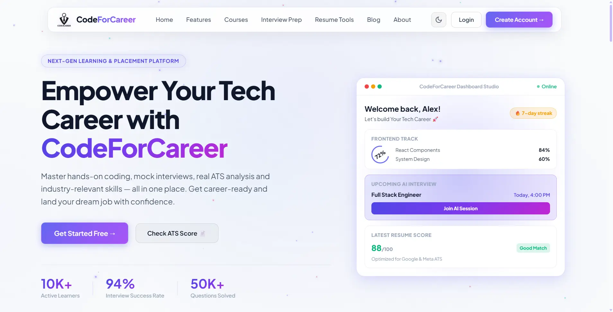
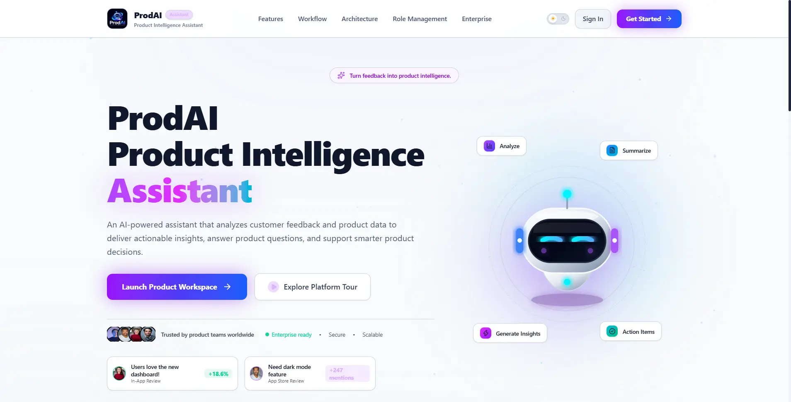
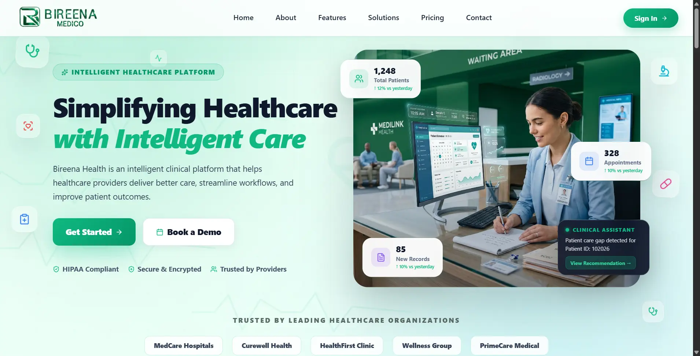
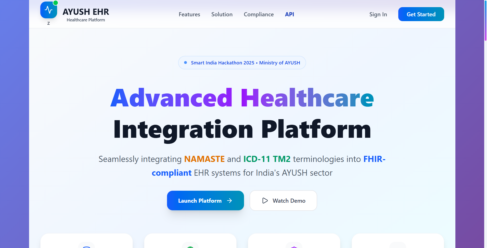

<!-- BANNER (added at the top) -->

  

<h1 align="center">Hi 👋, I'm Satya Prem</h1>
<h3 align="center">Backend & Full-Stack Developer | Software Engineering Student | AI/ML Enthusiast</h3>

  

  
  
  
  

---

### 🚀 About Me

- 🎓 Pursuing **B.Tech in Computer Science & Engineering** at **Shri Ram Institute of Technology, Jabalpur** (CGPA: 8.23 | 2023–2027).
- 💼 Currently working as a **Technical Lead Intern at Urmila Shree Sports Club Foundation** (October 2026 – Present), leading website development, digital platform management, and technical operations.
- 🤖 Completed **AI/ML Virtual Internship at Infosys Springboard** (August – October 2026), working on an AI-powered Product Intelligence Platform.
- 💻 Previously worked as a **Full Stack Developer Intern at Bireena Infotech** (April – July 2026), developing a Hospital Management System.
- 🛠️ Experienced in **Java, JavaScript, React.js, Node.js, Express.js, MongoDB, PostgreSQL, REST APIs, and Generative AI**.
- 🧠 Interested in **Backend Engineering, AI/ML, Scalable Systems, and Software Architecture**.
- 🏆 **GATE 2026 Qualified**.
- 🏅 Achieved **Global Rank 2629 in TCS CodeVita Season 13**.
- 📫 Reach me at **satyaprem619@gmail.com**.

---

### 🛠️ Tech Stack

  

| Category | Technologies |
|---|---|
| **Languages** | Java, Python, JavaScript, TypeScript, C#, C++, C, SQL |
| **Frontend** | React.js, Next.js, HTML5, CSS3, Tailwind CSS |
| **Backend & APIs** | Node.js, Express.js, Flask, FastAPI, .NET (Learning), Spring Boot (Learning), REST APIs, JWT, RAG |
| **Databases** | MongoDB, MySQL, PostgreSQL, Supabase |
| **AI/ML & GenAI** | Scikit-learn, NumPy, Pandas, Gemini API, Embeddings, AI Agents |
| **Core CS** | DSA, OOP, DBMS, Operating Systems, Computer Networks, Software Engineering |
---

### 💼 Internship Experience

**1. Technical Lead Intern — Urmila Shree Sports Club Foundation** | *October 2026 – Present*
- Leading website development, digital platform management, and technical operations.

**2. AI/ML Intern — Infosys Springboard** | *August 2026 – October 2026*
- Worked on an AI-powered Product Intelligence Platform for customer feedback analysis, product planning, and requirements generation.

**3. Full Stack Developer Intern — Bireena Infotech** | *April 2026 – July 2026*
- Developed **Bireena Medico**, a hospital management system.
- Built modules for patient records, appointments, billing, and authentication.

**4. Web Development Intern — Yashi IT Services** | *August 2025 – September 2025*
- Developed responsive websites using HTML, CSS, JavaScript, and Tailwind CSS.
- Customized Shopify and WordPress themes, plugins, and layouts.

**5. Intern — Cisco** | *2024, 2025 & 2026*
- Completed virtual internships and training in Cybersecurity, Networking, and Artificial Intelligence.

---
### 📂 Featured Projects

<table>
  <tr>
    <td width="50%">
      
      <h3>🎓 E-Learning Platform (CodeForCareer)</h3>
      Full-stack e-learning platform with authentication, course management, and a student dashboard. React frontend integrated with backend APIs and a database, built for a smooth, responsive user experience.
        
      <b>Tech:</b> React, Node.js, Express, MongoDB
          
    🔗 <a href="https://codeforcareer.vercel.app/" target="_blank">Live Demo</a> &nbsp;|&nbsp; <a href="https://github.com/SATYA-PREM/Code4career" target="_blank">Source</a>
    </td>   
<td width="50%">
  
  <h3>🤖 Product Intelligence AI – AI-Powered Product Analytics Platform</h3>
  An AI-driven platform that automates CSV data ingestion, validation, cleaning, and analysis using intelligent AI agents. Integrates structured data processing with AI-powered insights to support product analysis and data-driven decision-making.
    
  <b>Tech:</b> Python, FastAPI, MongoDB, Pandas, Google Gemini API, AI Agents
   
  🔗 <a href="#" target="_blank">Live Demo</a> &nbsp;|&nbsp;
  <a href="#" target="_blank">Source</a>
</td>   
  </tr>
  <tr>
     <td width="50%">
      
      <h3>🏥 Bireena Medico</h3>
      A full-stack Hospital Management System designed to streamline healthcare operations with secure patient records, appointment scheduling, doctor management, pharmacy, billing, and administrative dashboards.
        
      <b>Tech:</b> React, Node.js, Express.js, MongoDB
       
      🔗 <a href="https://hospital-management-system-five-khaki.vercel.app/" target="_blank">Live Demo</a> &nbsp;|&nbsp;
      <a href="https://github.com/SATYA-PREM/BIREENA-MEDICO" target="_blank">Source</a>
    </td>
    <td width="50%">
      
      <h3>🧠 LearnWise AI – GenAI-Powered Adaptive Learning & Career Mentor</h3>
      An AI-powered adaptive learning and career mentoring platform that generates personalized learning roadmaps, conducts diagnostic assessments, creates remedial learning plans, and provides career simulations. Includes an AI Resume Analyzer and intelligent learning recommendations powered by Google Gemini.
        
      <b>Tech:</b> React.js, Node.js, Express.js, MongoDB Atlas, Google Gemini API, JWT, REST APIs
       
      🔗 <a href="https://ai-path-recomender-satya.vercel.app/" target="_blank">Live Demo</a> &nbsp;|&nbsp; <a href="https://github.com/SATYA-PREM" target="_blank">Source</a>
    </td>
    
  </tr>
 
</table>

---

### 📊 GitHub Stats

  
  

  

  

  

---

### 🏆 Achievements

- ✅ **GATE 2026 Qualified**
- 🌐 **TCS CodeVita Season 13** – Global Rank 2629
- 💼 Completed **5+ Internships** across AI/ML, Cybersecurity, Networking & Full Stack Development
- 🎖️ **AWS Academy Graduate** – Cloud, ML & NLP Foundations
- 🚀 Delivered **5+ Professional Websites** for clients
- 💡 **Smart India Hackathon** – Participant (2024 & 2025)
---

<!-- SNAKE CONTRIBUTION GRAPH (added at the bottom) -->
<picture>
  <source media="(prefers-color-scheme: dark)" srcset="https://raw.githubusercontent.com/SATYA-PREM/SATYA-PREM/output/github-contribution-grid-snake-dark.svg" />
  <source media="(prefers-color-scheme: light)" srcset="https://raw.githubusercontent.com/SATYA-PREM/SATYA-PREM/output/github-contribution-grid-snake.svg" />
  
</picture>

  

